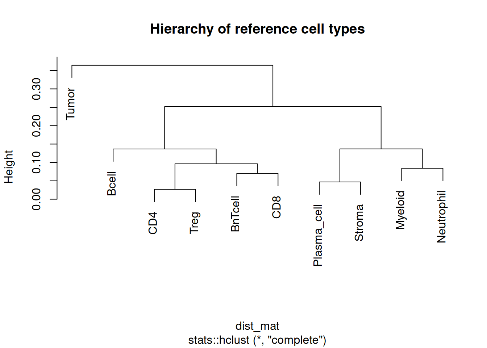
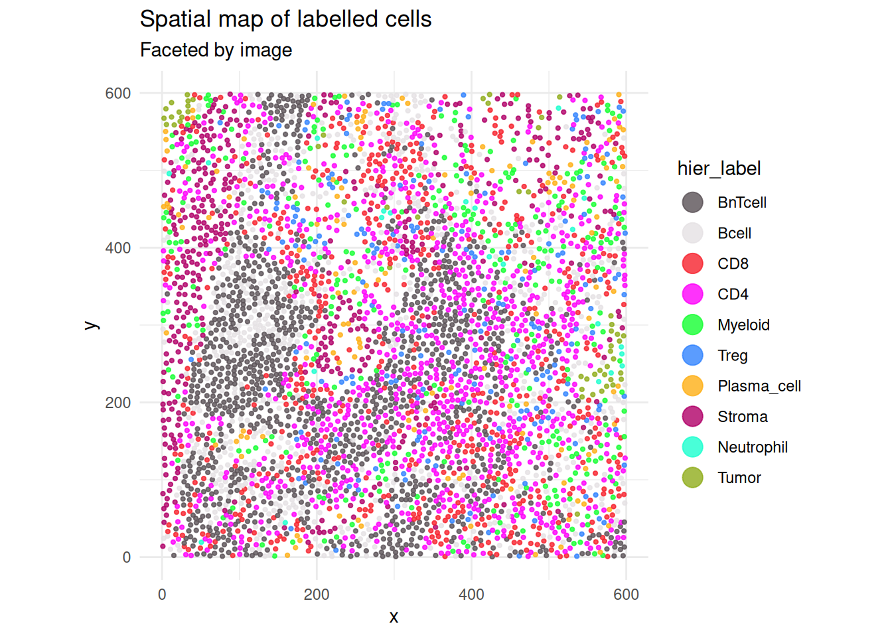

# Hierarchical kNN Classification

## 1 Overview

Flat classifiers predict among all cell types in a single step.
Hierarchical k-nearest-neighbour (kNN) classification instead organizes
reference cell types into a tree and predicts one branch at a time. Each
internal node separates the cell types on its left branch from those on
its right branch. A cell moves recursively through the hierarchy until
it reaches a terminal cell type or fails the confidence and agreement
requirements.

This vignette demonstrates the complete hierarchical kNN workflow on one
complete image from `cytoGateR_example`.

``` r

library(cytoGateR)
data("cytoGateR_example", package = "cytoGateR")

image_ids <- SummarizedExperiment::colData(cytoGateR_example)$image_name
spe <- cytoGateR_example[, image_ids == image_ids[1L]]
spe
```

    class: SpatialExperiment
    dim: 40 4363
    metadata(0):
    assays(1): exprs
    rownames(40): MPO H3 ... DNA1 DNA2
    rowData names(0):
    colnames(4363): 12_1 12_2 ... 12_4371 12_4372
    colData names(28): sample_id image_name ... KNN_P_Treg KNN_P_Tumor
    reducedDimNames(0):
    mainExpName: IMMUcan_2022_CancerExample_v1
    altExpNames(0):
    spatialCoords names(2) : cell_x cell_y
    imgData names(1): sample_id

## 2 Prepare reference labels

The packaged `core_group` column contains high-confidence labels
produced by tree gating. Cells outside the high-confidence reference are
marked `"Unassigned"`. The hierarchy builders use `"Unknown"` for cells
that should not contribute to the reference, so the labels are
harmonized before fitting.

``` r

cd <- SummarizedExperiment::colData(spe)
cd$hier_reference_label <- as.character(cd$core_group)
cd$hier_reference_label[cd$hier_reference_label == "Unassigned"] <- "Unknown"
SummarizedExperiment::colData(spe) <- cd

table(SummarizedExperiment::colData(spe)$hier_reference_label)
```


          Bcell     BnTcell         CD4         CD8     Myeloid  Neutrophil
            236         337         227         206         108          12
    Plasma_cell      Stroma        Treg       Tumor     Unknown
             40          71         125          16        2985 

## 3 Build the lineage hierarchy

[`build_lineage_hierarchy()`](https://sydneybiox.github.io/cytoGateR/reference/build_lineage_hierarchy.md)
calculates the average marker-expression profile for each reference cell
type and hierarchically clusters those profiles.

``` r

hc_tree <- build_lineage_hierarchy(
  spe,
  label_col = "hier_reference_label",
  assay_name = "exprs"
)

hc_tree$labels
```

     [1] "BnTcell"     "CD4"         "Bcell"       "Treg"        "Plasma_cell"
     [6] "Myeloid"     "CD8"         "Stroma"      "Tumor"       "Neutrophil" 

``` r

plot(hc_tree, main = "Hierarchy of reference cell types")
```



## 4 Build node-specific references

Each internal node receives its own binary training reference. Labels
are converted to `"Left"` and `"Right"` according to the branches of
`hc_tree`.

Setting `top_n = NULL` uses all available markers at each node. For
larger panels, `marker_stats` and `top_n` can be supplied to retain only
the most informative markers for each split.

``` r

hier_reference <- build_hierarchical_reference(
  spe,
  hc_tree,
  label_col = "hier_reference_label",
  top_n = NULL,
  assay_name = "exprs",
  unknown_label = "Unknown"
)

names(hier_reference)
```

    [1] "Node_1" "Node_2" "Node_3" "Node_4" "Node_5" "Node_6" "Node_7" "Node_8"
    [9] "Node_9"

Inspect the root-node reference:

``` r

root_name <- paste0("Node_", nrow(hc_tree$merge))
root_reference <- hier_reference[[root_name]]

dim(root_reference$train_data)
```

    [1] 1378   40

``` r

table(root_reference$train_labels)
```


     Left Right
       16  1362 

``` r

root_reference$left_members
```

    [1] "Tumor"

``` r

root_reference$right_members
```

    [1] "Bcell"       "CD4"         "Treg"        "BnTcell"     "CD8"
    [6] "Plasma_cell" "Stroma"      "Myeloid"     "Neutrophil" 

## 5 Run recursive hierarchical kNN

At each node,
[`predict_hierarchical_knn_recursive()`](https://sydneybiox.github.io/cytoGateR/reference/predict_hierarchical_knn_recursive.md)
creates an ensemble of weighted kNN predictions. A prediction is
accepted only when both its average probability and ensemble agreement
pass their thresholds.

The vignette uses one distance method and one repeat for speed.
Production analyses can use multiple distance methods and additional
repeats for a more stable ensemble.

``` r

set.seed(1)
spe <- predict_hierarchical_knn_recursive(
  spe,
  hier_reference,
  hc_tree,
  assay_name = "exprs",
  threshold = 0.5,
  agreement_threshold = 0.5,
  k = 3,
  repeats = 1,
  dist_methods = "pearson",
  BPPARAM = BiocParallel::SerialParam(),
  out_col = "hier_label",
  chunk_size = 1000,
  unassigned_label = "Unassigned"
)
```

## 6 Inspect hierarchical predictions

``` r

table(SummarizedExperiment::colData(spe)$hier_label)
```


          Bcell     BnTcell         CD4         CD8     Myeloid  Neutrophil
            581        1178         882         592         296          22
    Plasma_cell      Stroma        Treg       Tumor
            136         425         198          53 

The predictions can be compared with labels already stored in the demo
object:

``` r

label_confusion_matrix(
  spe,
  label_col1 = "knn_label",
  label_col2 = "hier_label"
)
```

                 v2
    v1            Bcell BnTcell  CD4  CD8 Myeloid Neutrophil Plasma_cell Stroma
      Bcell         479       8   18    8      21          0          16      2
      BnTcell        60    1068  101   64       0          0           0      1
      CD4             4      32  686    7       5          0           5     10
      CD8             0      43   13  457       3          0           7     16
      Myeloid        14       0   13    5     250          3           7     13
      Neutrophil      4       0    3    0       6         18           5      4
      Plasma_cell     1       0    2    3       1          0          48      6
      Stroma          6       0    0    0       2          1          34    356
      Treg            0      11   18    0       0          0           1      2
      Tumor           0       0    0   29       0          0           1      4
      Unassigned     13      16   28   19       8          0          12     11
                 v2
    v1            Treg Tumor Unassigned
      Bcell          3     0          0
      BnTcell       16     0          0
      CD4           26     0          0
      CD8            0     1          0
      Myeloid        1     0          0
      Neutrophil     0     1          0
      Plasma_cell    0     0          0
      Stroma         1     0          0
      Treg         143     0          0
      Tumor          0    51          0
      Unassigned     8     0          0

``` r

label_agreement_rates(
  spe,
  label_col1 = "knn_label",
  label_col2 = "hier_label"
)
```

             label match_n union_n agreement
    1        Bcell     479     657 0.7290715
    2      BnTcell    1068    1420 0.7521127
    3          CD4     686     971 0.7064882
    4          CD8     457     675 0.6770370
    5      Myeloid     250     352 0.7102273
    6   Neutrophil      18      45 0.4000000
    7  Plasma_cell      48     149 0.3221477
    8       Stroma     356     469 0.7590618
    9         Treg     143     230 0.6217391
    10       Tumor      51      87 0.5862069
    11  Unassigned       0     115 0.0000000

Finally, display the hierarchical predictions in spatial coordinates:

``` r

plot_labelled_cells(
  spe,
  col_label = "hier_label",
  image_col = "image_name"
)
```



## 7 Production settings

A larger ensemble can combine correlation- and angle-based similarity
measures:

``` r

spe <- predict_hierarchical_knn_recursive(
  spe,
  hier_reference,
  hc_tree,
  threshold = 0.7,
  agreement_threshold = 0.8,
  k = 5,
  repeats = 5,
  dist_methods = c("pearson", "cosine"),
  BPPARAM = BiocParallel::SerialParam()
)
```

## 8 Session information

``` r

sessionInfo()
```

    R version 4.6.1 (2026-06-24)
    Platform: x86_64-pc-linux-gnu
    Running under: Ubuntu 24.04.5 LTS

    Matrix products: default
    BLAS:   /usr/lib/x86_64-linux-gnu/openblas-pthread/libblas.so.3
    LAPACK: /usr/lib/x86_64-linux-gnu/openblas-pthread/libopenblasp-r0.3.26.so;  LAPACK version 3.12.0

    locale:
     [1] LC_CTYPE=C.UTF-8       LC_NUMERIC=C           LC_TIME=C.UTF-8
     [4] LC_COLLATE=C.UTF-8     LC_MONETARY=C.UTF-8    LC_MESSAGES=C.UTF-8
     [7] LC_PAPER=C.UTF-8       LC_NAME=C              LC_ADDRESS=C
    [10] LC_TELEPHONE=C         LC_MEASUREMENT=C.UTF-8 LC_IDENTIFICATION=C

    time zone: UTC
    tzcode source: system (glibc)

    attached base packages:
    [1] stats     graphics  grDevices utils     datasets  methods   base

    other attached packages:
    [1] cytoGateR_0.99.0

    loaded via a namespace (and not attached):
     [1] SummarizedExperiment_1.42.0 gtable_0.3.6
     [3] rjson_0.2.23                xfun_0.61
     [5] ggplot2_4.0.3               ggrepel_0.9.8
     [7] Biobase_2.72.0              lattice_0.22-9
     [9] vctrs_0.7.3                 tools_4.6.1
    [11] generics_0.1.4              parallel_4.6.1
    [13] stats4_4.6.1                proxy_0.4-29
    [15] tibble_3.3.1                pkgconfig_2.0.3
    [17] Matrix_1.7-5                RColorBrewer_1.1-3
    [19] pals_1.10                   S7_0.2.2
    [21] S4Vectors_0.50.3            lifecycle_1.0.5
    [23] compiler_4.6.1              farver_2.1.2
    [25] ggforce_0.5.0               mapproj_1.2.12
    [27] codetools_0.2-20            Seqinfo_1.2.0
    [29] graphlayouts_1.2.5          maps_3.4.3
    [31] htmltools_0.5.9             yaml_2.3.12
    [33] pillar_1.11.1               tidyr_1.3.2
    [35] MASS_7.3-65                 BiocParallel_1.46.0
    [37] SingleCellExperiment_1.34.0 DelayedArray_0.38.2
    [39] cachem_1.1.0                dbscan_1.2.7
    [41] magick_2.9.1                viridis_0.6.5
    [43] abind_1.4-8                 mclust_6.1.3
    [45] tidyselect_1.2.1            digest_0.6.39
    [47] dplyr_1.2.1                 purrr_1.2.2
    [49] labeling_0.4.3              polyclip_1.10-7
    [51] fastmap_1.2.0               grid_4.6.1
    [53] colorspace_2.1-4            cli_3.6.6
    [55] SparseArray_1.12.3          magrittr_2.0.5
    [57] S4Arrays_1.12.1             dichromat_2.0-1
    [59] ggraph_2.2.2                tidygraph_1.3.1
    [61] withr_3.0.3                 scales_1.4.0
    [63] rmarkdown_2.32              XVector_0.52.0
    [65] matrixStats_1.5.0           igraph_2.3.4
    [67] otel_0.2.0                  gridExtra_2.3.1
    [69] SpatialExperiment_1.22.0    memoise_2.0.1
    [71] evaluate_1.0.5              knitr_1.52
    [73] GenomicRanges_1.64.0        IRanges_2.46.0
    [75] viridisLite_0.4.3           rlang_1.3.0
    [77] Rcpp_1.1.2                  glue_1.8.1
    [79] tweenr_2.0.3                BiocGenerics_0.58.1
    [81] jsonlite_2.0.0              R6_2.6.1
    [83] MatrixGenerics_1.24.0      
