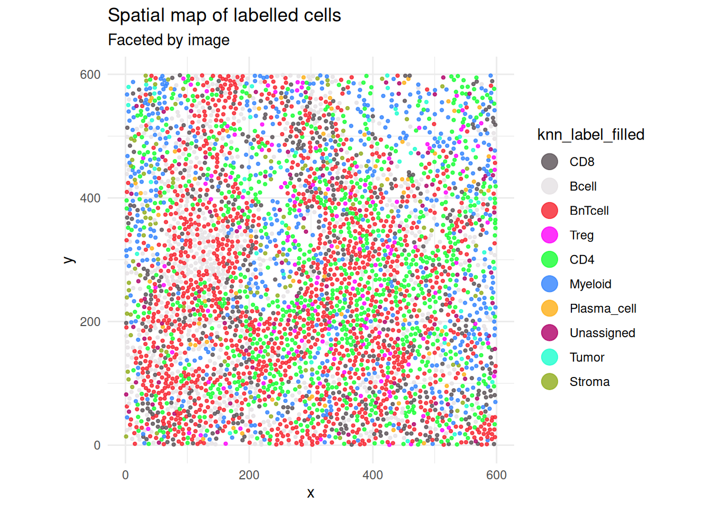

# Machine-Learning Prediction

## 1 Overview

Tree gating can identify high-confidence reference cells while leaving
ambiguous cells unassigned. This vignette uses the stored `core_group`
labels to train a weighted k-nearest-neighbour classifier and predict
the remaining cells.

The example uses one complete image and reduced cross-validation
settings to remain suitable for package checks.

``` r

library(cytoGateR)
data("cytoGateR_example", package = "cytoGateR")

image_ids <- SummarizedExperiment::colData(cytoGateR_example)$image_name
spe <- cytoGateR_example[, image_ids == image_ids[1L]]
table(SummarizedExperiment::colData(spe)$core_group)
```


          Bcell     BnTcell         CD4         CD8     Myeloid  Neutrophil
            236         337         227         206         108          12
    Plasma_cell      Stroma        Treg       Tumor  Unassigned
             40          71         125          16        2985 

## 2 Train a weighted kNN reference

Only cells with a known `core_group` label are used during reference
cleaning. The `"Unassigned"` cells are retained for subsequent
prediction.

``` r

knn_reference <- train_custom_knn(
  spe,
  label_col = "core_group",
  assay_name = "exprs",
  unknown_label = "Unassigned",
  features = c("CD3e", "CD20", "CD4", "CD8a"),
  cv_folds = 2,
  repeats = 1,
  agreement_thresh = 0.5,
  k = 3,
  method = "pearson",
  seed = 1,
  BPPARAM = BiocParallel::SerialParam()
)
```

The returned object contains a cleaned reference and cross-validated
probabilities for retained reference cells:

``` r

names(knn_reference)
```

    [1] "spe"             "model"           "core_prob_mat"   "agreement_rates"
    [5] "features_used"  

``` r

dim(knn_reference$model$reference_data)
```

    [1] 782   4

``` r

table(knn_reference$model$reference_labels)
```


          Bcell     BnTcell         CD4         CD8     Myeloid  Neutrophil
            175         197         154         165          52           0
    Plasma_cell      Stroma        Treg       Tumor
              6           7          24           2 

## 3 Predict unassigned cells

``` r

knn_prediction <- predict_unknown_with_knn(
  knn_reference$spe,
  knn_reference,
  assay_name = "exprs",
  label_col = "cleaned_core_label",
  out_col = "knn_label_filled",
  pred_col = "knn_pred",
  unknown_label = "Unassigned",
  threshold = 0.5,
  k = 3,
  dist_method = "pearson"
)
```

``` r

prediction_cd <- SummarizedExperiment::colData(knn_prediction$spe)
table(prediction_cd$knn_label_filled)
```


          Bcell     BnTcell         CD4         CD8     Myeloid Plasma_cell
            603        1369         861         502         564          66
         Stroma        Treg       Tumor  Unassigned
            106         131          59         102 

``` r

summary(prediction_cd$knn_confidence)
```

       Min. 1st Qu.  Median    Mean 3rd Qu.    Max.     NAs
     0.3334  0.6670  1.0000  0.8771  1.0000  1.0000     782 

## 4 Assemble the full probability matrix

[`train_custom_knn()`](https://sydneybiox.github.io/cytoGateR/reference/train_custom_knn.md)
returns probabilities for retained reference cells, while
[`predict_unknown_with_knn()`](https://sydneybiox.github.io/cytoGateR/reference/predict_unknown_with_knn.md)
returns probabilities for predicted cells. They can be combined and
aligned to the cells present in the updated object.

``` r

full_prob_mat <- rbind(
  knn_reference$core_prob_mat,
  knn_prediction$prob_mat
)
full_prob_mat <- full_prob_mat[colnames(knn_prediction$spe), , drop = FALSE]

dim(full_prob_mat)
```

    [1] 4363   10

``` r

summary(rowSums(full_prob_mat))
```

       Min. 1st Qu.  Median    Mean 3rd Qu.    Max.
          1       1       1       1       1       1 

## 5 Quantify uncertainty

The uncertainty calculation combines probability-distribution measures
with a sample-aware spatial-discordance score.

``` r

uncertainty <- calculate_uncertainty(
  full_prob_mat,
  knn_prediction$spe,
  sample_col = "sample_id",
  k_spatial = 3
)
head(uncertainty)
```

         cell_id   entropy gini_impurity margin_uncertainty spatial_discordance
    12_1    12_1 0.0000000     0.0000000          0.0000000           0.3333333
    12_2    12_2 0.0000000     0.0000000          0.0000000           0.3333333
    12_3    12_3 0.0000000     0.0000000          0.0000000           0.3333333
    12_4    12_4 0.0000000     0.0000000          0.0000000           1.0000000
    12_5    12_5 0.2763651     0.4936561          0.6662051           1.0000000
    12_6    12_6 0.2764426     0.4938469          0.6667198           0.6666667

## 6 Compare labels

``` r

label_confusion_matrix(
  knn_prediction$spe,
  label_col1 = "cell_type_hard",
  label_col2 = "knn_label_filled"
)
```

                 v2
    v1            Bcell BnTcell  CD4  CD8 Myeloid Neutrophil Plasma_cell Stroma
      Bcell         212      21    3    3      33          0           5      7
      BnTcell       256    1197  526  344      56          0          11      4
      CD4             0       0    5    0       0          0           0      0
      CD8             0       4    1   78       0          0           1      0
      Myeloid        52      30   74   39     314          0          34     45
      Neutrophil      5       0    3    1      27          0           1      8
      Plasma_cell     0       0    1    0       1          0           0      1
      Stroma          0       1    2    1       5          0           1      0
      Treg            0       5  170    0      10          0           2      0
      Tumor           0       0    0    0       1          0           0      0
      Unassigned      0       0    0    0       0          0           0      0
      Uncertain      78     111   76   36     117          0          11     41
                 v2
    v1            Treg Tumor Unassigned Uncertain
      Bcell          0     5          7         0
      BnTcell       80     3         29         0
      CD4            0     0          0         0
      CD8            1     0          2         0
      Myeloid        7    26         33         0
      Neutrophil     1     8          0         0
      Plasma_cell    0     0          0         0
      Stroma         0     0          1         0
      Treg          33     3          3         0
      Tumor          0     0          0         0
      Unassigned     0     0          0         0
      Uncertain      9    14         27         0

``` r

plot_labelled_cells(
  knn_prediction$spe,
  col_label = "knn_label_filled",
  image_col = "image_name"
)
```



## 7 Other classifiers

`cytoGateR` also provides random-forest and optional Torch-based
deep-learning classifiers. They use the same core-label and unknown-cell
workflow. The following production alternatives are not evaluated during
vignette building.

``` r

rf_reference <- train_custom_randomforest(
  spe,
  label_col = "core_group",
  unknown_label = "Unassigned",
  cv_folds = 5,
  repeats = 10,
  seed = 1
)

dl_reference <- train_custom_dl(
  spe,
  label_col = "core_group",
  unknown_label = "Unassigned",
  epochs = 50,
  cv_folds = 5,
  repeats = 3,
  seed = 1
)
```

## 8 Session information

``` r

sessionInfo()
```

    R version 4.6.1 (2026-06-24)
    Platform: x86_64-pc-linux-gnu
    Running under: Ubuntu 24.04.5 LTS

    Matrix products: default
    BLAS:   /usr/lib/x86_64-linux-gnu/openblas-pthread/libblas.so.3
    LAPACK: /usr/lib/x86_64-linux-gnu/openblas-pthread/libopenblasp-r0.3.26.so;  LAPACK version 3.12.0

    locale:
     [1] LC_CTYPE=C.UTF-8       LC_NUMERIC=C           LC_TIME=C.UTF-8
     [4] LC_COLLATE=C.UTF-8     LC_MONETARY=C.UTF-8    LC_MESSAGES=C.UTF-8
     [7] LC_PAPER=C.UTF-8       LC_NAME=C              LC_ADDRESS=C
    [10] LC_TELEPHONE=C         LC_MEASUREMENT=C.UTF-8 LC_IDENTIFICATION=C

    time zone: UTC
    tzcode source: system (glibc)

    attached base packages:
    [1] stats     graphics  grDevices utils     datasets  methods   base

    other attached packages:
    [1] cytoGateR_0.99.0

    loaded via a namespace (and not attached):
     [1] SummarizedExperiment_1.42.0 gtable_0.3.6
     [3] rjson_0.2.23                xfun_0.61
     [5] ggplot2_4.0.3               ggrepel_0.9.8
     [7] Biobase_2.72.0              lattice_0.22-9
     [9] vctrs_0.7.3                 tools_4.6.1
    [11] generics_0.1.4              parallel_4.6.1
    [13] stats4_4.6.1                proxy_0.4-29
    [15] tibble_3.3.1                pkgconfig_2.0.3
    [17] Matrix_1.7-5                RColorBrewer_1.1-3
    [19] pals_1.10                   S7_0.2.2
    [21] S4Vectors_0.50.3            lifecycle_1.0.5
    [23] compiler_4.6.1              farver_2.1.2
    [25] ggforce_0.5.0               mapproj_1.2.12
    [27] codetools_0.2-20            Seqinfo_1.2.0
    [29] graphlayouts_1.2.5          maps_3.4.3
    [31] htmltools_0.5.9             yaml_2.3.12
    [33] pillar_1.11.1               tidyr_1.3.2
    [35] MASS_7.3-65                 BiocParallel_1.46.0
    [37] SingleCellExperiment_1.34.0 DelayedArray_0.38.2
    [39] cachem_1.1.0                dbscan_1.2.7
    [41] magick_2.9.1                viridis_0.6.5
    [43] abind_1.4-8                 mclust_6.1.3
    [45] tidyselect_1.2.1            digest_0.6.39
    [47] dplyr_1.2.1                 purrr_1.2.2
    [49] labeling_0.4.3              polyclip_1.10-7
    [51] fastmap_1.2.0               grid_4.6.1
    [53] colorspace_2.1-4            cli_3.6.6
    [55] SparseArray_1.12.3          magrittr_2.0.5
    [57] S4Arrays_1.12.1             dichromat_2.0-1
    [59] ggraph_2.2.2                tidygraph_1.3.1
    [61] withr_3.0.3                 scales_1.4.0
    [63] rmarkdown_2.32              XVector_0.52.0
    [65] matrixStats_1.5.0           igraph_2.3.4
    [67] otel_0.2.0                  gridExtra_2.3.1
    [69] SpatialExperiment_1.22.0    memoise_2.0.1
    [71] evaluate_1.0.5              knitr_1.52
    [73] GenomicRanges_1.64.0        IRanges_2.46.0
    [75] viridisLite_0.4.3           rlang_1.3.0
    [77] Rcpp_1.1.2                  glue_1.8.1
    [79] tweenr_2.0.3                BiocGenerics_0.58.1
    [81] jsonlite_2.0.0              R6_2.6.1
    [83] MatrixGenerics_1.24.0      
