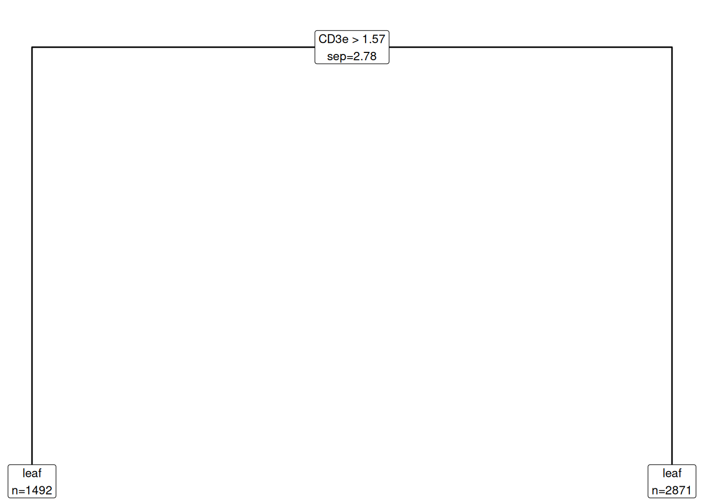
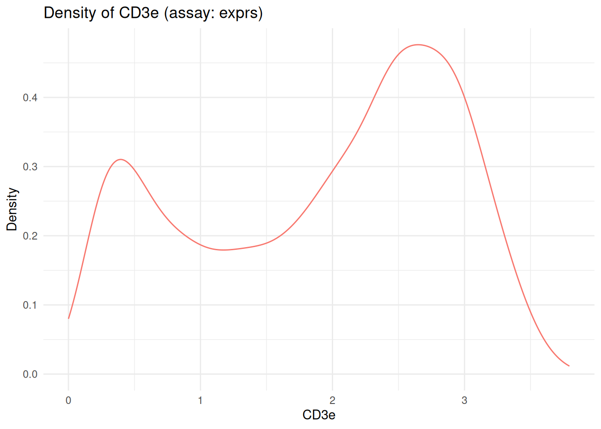
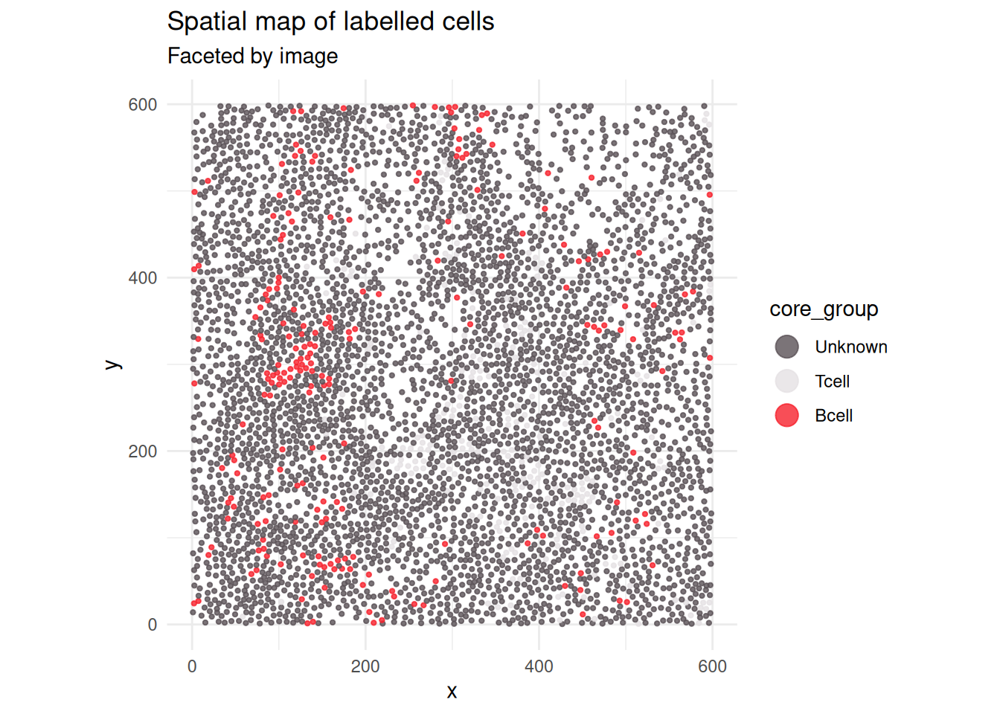
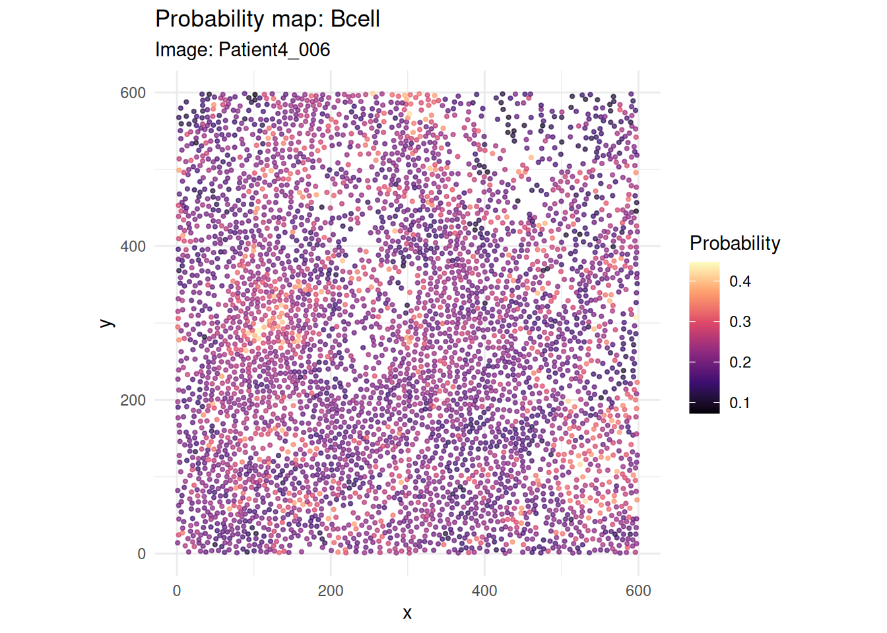
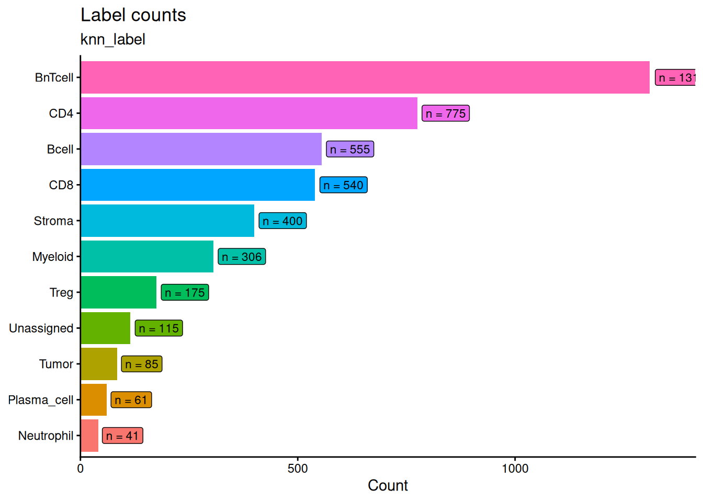

# Tree Gating and Visualisation

## 1 Overview

This vignette demonstrates an interpretable tree-gating workflow on one
complete image from `cytoGateR_example`. A small two-lineage marker
table keeps the build fast while exercising the same functions used by
larger analyses.

``` r

library(cytoGateR)
data("cytoGateR_example", package = "cytoGateR")

image_ids <- SummarizedExperiment::colData(cytoGateR_example)$image_name
spe <- cytoGateR_example[, image_ids == image_ids[1L]]
spe
```

    class: SpatialExperiment
    dim: 40 4363
    metadata(0):
    assays(1): exprs
    rownames(40): MPO H3 ... DNA1 DNA2
    rowData names(0):
    colnames(4363): 12_1 12_2 ... 12_4371 12_4372
    colData names(28): sample_id image_name ... KNN_P_Treg KNN_P_Tumor
    reducedDimNames(0):
    mainExpName: IMMUcan_2022_CancerExample_v1
    altExpNames(0):
    spatialCoords names(2) : cell_x cell_y
    imgData names(1): sample_id

## 2 Define a lineage table

Each row defines a cell type using positive and negative protein
markers. Marker columns are list-columns so that each cell type may use
a different number of markers.

``` r

lineage_table <- data.frame(
  cell_type = c("Tcell", "Bcell"),
  pos_markers = I(list("CD3e", "CD20")),
  neg_markers = I(list("CD20", "CD3e"))
)
lineage_table
```

      cell_type pos_markers neg_markers
    1     Tcell        CD3e        CD20
    2     Bcell        CD20        CD3e

## 3 Fit tree-gating models

For package-build speed, the example limits each tree to one split.
Larger analyses can increase `max_depth` and use more detailed marker
definitions.

``` r

tree_result <- run_tree_gating(
  spe,
  lineage_table,
  assay_name = "exprs",
  max_depth = 1,
  min_cells = 100,
  min_score = 0.1,
  uncert_thresh = 0.25,
  workers = 1
)
```

The result contains the updated object, fitted trees, probability
matrix, hard labels, and cleaned lineage table:

``` r

names(tree_result)
```

    [1] "spe"           "trees"         "prob_mat"      "hard_label"
    [5] "lineage_table"

``` r

head(tree_result$prob_mat)
```

             Tcell      Bcell
    [1,] 0.2420305 0.10869419
    [2,] 0.1044278 0.20918995
    [3,] 0.1894046 0.19044741
    [4,] 0.2154580 0.14175041
    [5,] 0.2096679 0.14963762
    [6,] 0.2576016 0.07941126

``` r

table(tree_result$hard_label)
```


        Bcell     Tcell Uncertain
          101       686      3576 

## 4 Inspect the fitted trees

``` r

print_celltype_tree(tree_result$trees$Tcell)
```

    [depth 0] CD3e > 1.565  (sep = 2.78, n = 4363)
     |- low
     |  [leaf] depth =1 n_cells =1492
     `- high
        [leaf] depth =1 n_cells =2871

``` r

plot_celltype_tree(tree_result$trees$Tcell)
```



## 5 Select high-confidence cells

[`apply_cutoff_labels()`](https://sydneybiox.github.io/cytoGateR/reference/apply_cutoff_labels.md)
applies a cell-type-specific probability cutoff. A cell receives a
reference label only when exactly one cell type passes its cutoff.

``` r

core_result <- apply_cutoff_labels(
  tree_result,
  cutoff_fn = function(x) stats::quantile(x, 0.95, na.rm = TRUE),
  label_col = "core_group",
  unknown_label = "Unknown"
)

table(SummarizedExperiment::colData(core_result$spe)$core_group)
```


      Bcell   Tcell Unknown
        219     219    3925 

## 6 Visualise expression and annotations

Marker distributions help assess whether the selected markers separate
the expected populations.

``` r

plot_marker_density(
  core_result$spe,
  marker = "CD3e",
  assay_name = "exprs",
  image_col = "image_name"
)
```



The gated labels can also be displayed in spatial coordinates:

``` r

plot_labelled_cells(
  core_result$spe,
  col_label = "core_group",
  image_col = "image_name"
)
```



## 7 Visualise stored full-workflow probabilities

The packaged object contains probabilities from the full ten-lineage
demo workflow. These provide a richer example for probability
visualisation without rerunning the complete model during vignette
construction.

``` r

plot_probability_map(
  spe,
  cell_type = "Bcell",
  image_col = "image_name"
)
```



``` r

plot_label_counts(
  spe,
  label_col = "knn_label"
)
```



## 8 Session information

``` r

sessionInfo()
```

    R version 4.6.1 (2026-06-24)
    Platform: x86_64-pc-linux-gnu
    Running under: Ubuntu 24.04.5 LTS

    Matrix products: default
    BLAS:   /usr/lib/x86_64-linux-gnu/openblas-pthread/libblas.so.3
    LAPACK: /usr/lib/x86_64-linux-gnu/openblas-pthread/libopenblasp-r0.3.26.so;  LAPACK version 3.12.0

    locale:
     [1] LC_CTYPE=C.UTF-8       LC_NUMERIC=C           LC_TIME=C.UTF-8
     [4] LC_COLLATE=C.UTF-8     LC_MONETARY=C.UTF-8    LC_MESSAGES=C.UTF-8
     [7] LC_PAPER=C.UTF-8       LC_NAME=C              LC_ADDRESS=C
    [10] LC_TELEPHONE=C         LC_MEASUREMENT=C.UTF-8 LC_IDENTIFICATION=C

    time zone: UTC
    tzcode source: system (glibc)

    attached base packages:
    [1] stats     graphics  grDevices utils     datasets  methods   base

    other attached packages:
    [1] cytoGateR_0.99.0

    loaded via a namespace (and not attached):
     [1] SummarizedExperiment_1.42.0 gtable_0.3.6
     [3] rjson_0.2.23                xfun_0.61
     [5] ggplot2_4.0.3               ggrepel_0.9.8
     [7] Biobase_2.72.0              lattice_0.22-9
     [9] vctrs_0.7.3                 tools_4.6.1
    [11] generics_0.1.4              stats4_4.6.1
    [13] proxy_0.4-29                tibble_3.3.1
    [15] pkgconfig_2.0.3             Matrix_1.7-5
    [17] RColorBrewer_1.1-3          pals_1.10
    [19] S7_0.2.2                    S4Vectors_0.50.3
    [21] lifecycle_1.0.5             compiler_4.6.1
    [23] farver_2.1.2                ggforce_0.5.0
    [25] mapproj_1.2.12              Seqinfo_1.2.0
    [27] graphlayouts_1.2.5          maps_3.4.3
    [29] htmltools_0.5.9             yaml_2.3.12
    [31] pillar_1.11.1               tidyr_1.3.2
    [33] MASS_7.3-65                 SingleCellExperiment_1.34.0
    [35] DelayedArray_0.38.2         cachem_1.1.0
    [37] dbscan_1.2.7                magick_2.9.1
    [39] viridis_0.6.5               abind_1.4-8
    [41] mclust_6.1.3                tidyselect_1.2.1
    [43] digest_0.6.39               dplyr_1.2.1
    [45] purrr_1.2.2                 labeling_0.4.3
    [47] polyclip_1.10-7             fastmap_1.2.0
    [49] grid_4.6.1                  colorspace_2.1-4
    [51] cli_3.6.6                   SparseArray_1.12.3
    [53] magrittr_2.0.5              S4Arrays_1.12.1
    [55] dichromat_2.0-1             ggraph_2.2.2
    [57] tidygraph_1.3.1             withr_3.0.3
    [59] scales_1.4.0                rmarkdown_2.32
    [61] XVector_0.52.0              matrixStats_1.5.0
    [63] igraph_2.3.4                otel_0.2.0
    [65] gridExtra_2.3.1             SpatialExperiment_1.22.0
    [67] memoise_2.0.1               evaluate_1.0.5
    [69] knitr_1.52                  GenomicRanges_1.64.0
    [71] IRanges_2.46.0              viridisLite_0.4.3
    [73] rlang_1.3.0                 Rcpp_1.1.2
    [75] glue_1.8.1                  tweenr_2.0.3
    [77] BiocGenerics_0.58.1         jsonlite_2.0.0
    [79] R6_2.6.1                    MatrixGenerics_1.24.0      
